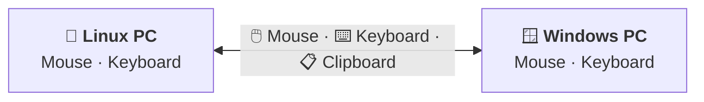

<p align="center">
  
</p>

<p align="center">
  Share your keyboard, mouse, and clipboard seamlessly between Linux and Windows, or between two Linux machines.
</p>

<p align="center">
  <a href="#features">Features</a> &bull;
  <a href="#installation">Installation</a> &bull;
  <a href="#quick-start">Quick Start</a> &bull;
  <a href="#how-it-works">How It Works</a> &bull;
  <a href="#configuration">Configuration</a> &bull;
  <a href="#contributing">Contributing</a>
</p>

<p align="center">
  
  
  
  
</p>

---

## What is this?

MWB Linux is a native Linux client that connects to **Microsoft PowerToys Mouse Without Borders** on Windows. Move your mouse to the edge of the screen, and it seamlessly jumps to the other machine — along with your keyboard and clipboard.



> Move your mouse to the screen edge — the cursor seamlessly jumps to the other machine.

No extra software needed on Windows beyond PowerToys, which bundles Mouse Without Borders.

## Features

- **Bidirectional mouse sharing** — Control both machines from either keyboard/mouse
- **Seamless edge switching** — Move cursor to screen edge, it appears on the other machine
- **Clipboard sync** — Copy text or images on one machine, paste on the other
- **Keyboard forwarding** — Type on your Linux keyboard, text appears on Windows
- **Full mouse support** — Scroll wheel, horizontal scroll, and side buttons (back/forward)
- **Encrypted** — AES-256-CBC encryption with PBKDF2 key derivation
- **Device isolation** — When controlling Windows, your Linux cursor doesn't move
- **Dual-mode connection** — Acts as both server and client for fast reconnection
- **Zero config on Windows** — Works with existing PowerToys MWB setup
- **Linux to Linux** — Two to six Linux machines in a row with `peer = "linux"`; no Windows PC needed
- **Optional settings window** — `mwb-gui` edits the config and shows live status
- **Lightweight** — Single binary, ~5MB, no GUI dependencies (the settings window is separate)

## Demo

| Direction | What happens |
|-----------|-------------|
| Mouse hits left edge on Linux | Cursor appears on Windows, Linux input disabled |
| Mouse hits right edge on Windows | Cursor returns to Linux, input restored |
| Ctrl+C on Windows | Text/image available on Linux clipboard |
| Ctrl+C on Linux | Text/image available on Windows clipboard |
| Type on Linux keyboard | Text appears in focused Windows app |

## Installation

**PowerToys compatibility:** v0.6.3 defaults to PowerToys 0.101 or newer.
If Windows runs PowerToys 0.100.2 or older, add `legacy_crypto = true` to
`~/.config/mwb/config.toml` before upgrading. Keep your existing security key.

### One-Line Install (Ubuntu/Debian)

```bash
curl -fsSL https://raw.githubusercontent.com/lucky-verma/mwb-linux/main/scripts/install.sh | sudo bash
```

### From .deb Package

Download the versioned `.deb` for your architecture from
[Releases](https://github.com/lucky-verma/mwb-linux/releases), then install it:

```bash
sudo apt install ./mwb-linux_*_amd64.deb
```

`apt` (rather than `dpkg -i`) also installs the dependencies, including GTK
for the settings window.

If apt prints `N: Download is performed unsandboxed as root as file ...
couldn't be accessed by user '_apt'`, that is only a notice, and the
install still works: apt's own user cannot read your home folder. Install
from a folder it can read to avoid it:

```bash
cp mwb-linux_*_amd64.deb /tmp/ && sudo apt install /tmp/mwb-linux_*_amd64.deb
``` The package does several things on install:

- installs `mwb` and the `mwb-gui` settings window
- adds the window to your app menu as **Mouse Without Borders**
- installs the background service and the device permission rules
- adds you to the `input` group when you install with `sudo`

Log out and back in once so the group change takes effect. Then open
Mouse Without Borders, enter the other computer and the security key, and
click Save and Start.

If you install from a graphical software store instead, add yourself to the
`input` group by hand with `sudo usermod -aG input $USER`. The store doesn't
say which user is installing, so the package can't do it for you.

To build the same package yourself, see
[Building the .deb package](#building-the-deb-package).

### From Binary

```bash
# Download binary
wget https://github.com/lucky-verma/mwb-linux/releases/latest/download/mwb-linux-amd64
chmod +x mwb-linux-amd64
sudo mv mwb-linux-amd64 /usr/local/bin/mwb

# Install dependencies
sudo apt install xdotool xclip

# Setup permissions
sudo bash -c 'modprobe uinput && echo uinput > /etc/modules-load.d/uinput.conf'
echo 'KERNEL=="uinput", GROUP="input", MODE="0660"' | sudo tee /etc/udev/rules.d/99-mwb-uinput.rules
sudo udevadm control --reload-rules
sudo usermod -aG input $USER
```

### With Go

```bash
go install github.com/lucky-verma/mwb-linux/cmd/mwb@latest
```

Puts `mwb` in `$(go env GOPATH)/bin`. You still need the system dependencies and
permissions from [From Binary](#from-binary): `xdotool`/`xclip`, the `uinput`
module, the udev rule, and membership of the `input` group. This build reports
`dev` for `mwb version`, since the release ldflags are not applied.

### From Source

```bash
git clone https://github.com/lucky-verma/mwb-linux.git
cd mwb-linux
make build
make install        # no sudo — installs a per-user service
systemctl --user enable --now mwb
```

`make install` is a per-user install: the binary goes to `~/go/bin/mwb` and the
service to `~/.config/systemd/user/`. Do **not** run it with `sudo` — that
installs under `root` and the `--user` service then can't find the binary.

The installed service runs receive-only mode (`mwb`) so it will not
unexpectedly send the Linux mouse to Windows. Use `mwb -bidi -edge left`
manually when you explicitly want Linux → Windows control.

It does not set up system dependencies. If this is a fresh machine, run the
dependency and permission steps from [From Binary](#from-binary) first
(`xdotool`/`xclip`, the `uinput` module, the udev rule, and the
`input` group).

> **Note:** Log out and back in after installation for group changes to take effect.
>
> **One installer at a time.** The one-line/`.deb`/binary methods install a
> system service that runs `/usr/local/bin/mwb`. `make install` installs a
> per-user service that runs `~/go/bin/mwb`. If you switch methods, stop and
> disable the old service first so you aren't running a stale binary.

## Updating

```bash
mwb update --check   # see what's available
mwb update           # download, verify and install
mwb update --restart # install and restart an active user service
```

`mwb update` fetches the release artifact for your architecture, verifies it
against the SHA-256 published in that release's `checksums.txt`, and replaces
the binary atomically — an interrupted update leaves either the old binary or
the new one, never a broken one. It refuses to install anything whose checksum
does not match, and only ever downloads from GitHub. Before replacement it
creates a versioned hard-link backup beside the binary, without overwriting an
existing backup.

A source build reports version `dev`, which cannot be ordered against a release.
The updater therefore refuses to replace it unless `--force` is supplied.

If mwb was installed from the `.deb`, `mwb update` will not overwrite it behind
dpkg's back; it points to the release `.deb` and the `dpkg` command instead. If the binary lives
somewhere only root can write, it tells you to re-run with `sudo`.

If updating requires `sudo`, run `sudo mwb update`, then run
`systemctl --user restart mwb.service` as your desktop user without sudo.
`sudo mwb update --restart` is rejected because it targets root's user manager.

The running service keeps using the old binary until it is restarted. Pass
`--restart` to do that after a successful update, or restart it separately:

```bash
systemctl --user restart mwb.service
```

## Quick Start

### 1. Get the security key from Windows

Open **PowerToys** → **Mouse Without Borders** → copy the **Security Key**.

### 2. Configure

```bash
mkdir -p ~/.config/mwb
cat > ~/.config/mwb/config.toml << EOF
host = "192.168.1.100"        # Your Windows machine's IP
key = "YourSecurityKey"       # From PowerToys MWB
name = "linux"                # This machine's name (max 15 chars)
keyboard_layout = "auto"      # Inbound keyboard layout profile
EOF
```

### 3. Run

```bash
# Receive only (Windows controls Linux)
mwb

# Bidirectional (Linux also controls Windows)
mwb -bidi -edge left
```

### 4. Add your Linux machine on Windows

In PowerToys MWB, enter the security key and device name to connect.

## Linux to Linux

Two to six Linux machines can share their keyboards and mice with no Windows
PC involved. Their screens sit in one row, left to right, and the pointer
walks across all of them. Setting up works like PowerToys: one computer
waits, and the others connect to it.

**In the settings window** (`mwb-gui`), on every computer. On a fresh
install the window is already filled in for this: a Linux peer, a new
security key, and waiting for the other computers, so the computer that
waits only needs **Save**.

1. Set **Other computer** to *Linux with mwb-linux*.
2. **Security key:** click Generate on one computer, then Copy it and use
   the same key everywhere.
3. **Address:** leave it empty on one computer, so that it waits. The window
   shows that computer's address. On each of the others, enter that address.
   You only ever enter one address: the computers tell each other where the
   rest are, and connect to all of them. With several networks (Wi-Fi and
   Ethernet, a VPN), **Network** picks the one to use; the address shown
   follows it.
4. **Name:** give each computer a different name.
5. Click **Save**, then **Start**.
6. Once they are connected, arrange the screens in the order they stand on
   your desk: with two, click to swap them; with more, drag them. Save. The
   other computers pick up the new order by themselves.

**In config files**, three machines look like this:

```toml
# On "desk", which waits
key = "PASTE-THE-SAME-KEY-EVERYWHERE"
name = "desk"
peer = "linux"
```

```toml
# On "laptop" and on "mini": the same, plus the desk's address
host = "192.168.1.20"
key = "PASTE-THE-SAME-KEY-EVERYWHERE"
name = "laptop"            # "mini" on the other one
peer = "linux"
```

Start mwb on all of them, for example with `systemctl --user enable --now mwb`.

Without further setup:

- **One pointer, any keyboard.** The pointer is on one computer at a time.
  Move it past a screen edge that touches another computer and it goes
  there; keep going and it crosses the next one. Whichever computer's
  keyboard and mouse you pick up drive it, because `bidirectional` defaults
  to on. Set `bidirectional = false` on a machine that should only be
  controlled.
- **The order stays in sync.** The screen order is stored as `layout` (with
  `layout_changed`, when it was chosen). The most recent choice wins and
  every computer saves it. A new computer joins on the right; drag it where
  it belongs.
- **Computers come and go.** If a computer goes offline, the pointer skips
  its screen. If it had the pointer, each of the others takes its own back
  within the 20-second silence timeout, and any key or mouse button it was
  holding down is released. It rejoins when it comes back.
- **Screen sizes are exchanged.** Each computer tells the others its screen
  size, so `remote_width` and `remote_height` are only a fallback.
- **Mistakes are reported.** The settings window lists which computers are
  online, and says so if one runs an older mwb that cannot join.

Two Linux machines set up before groups existed keep working: their `edge`
setting decides the order until a `layout` is saved. Every machine in a group
needs this version or newer.

Clipboard text and images go to every computer; a copied file is sent to
each computer that is online. Sending input needs X11 or XWayland on that
machine; see [Known Limitations](#known-limitations).

The computers accept connections only from the local network (private and
link-local addresses, never the internet or themselves), and only with the
shared key. Learned addresses are kept in `~/.local/state/mwb/members.json`.

Why `peer = "linux"` matters: each machine listens and dials at the same time.
PowerToys closes duplicate connections itself. mwb-linux machines have no
such referee, so for each pair they keep the connection dialed by the machine
whose name sorts first. A link that goes quiet for 20 seconds is dropped and
redialed. The group messages are an mwb-linux addition and are never sent to
PowerToys.

## Settings window

`mwb-gui` is an optional desktop window for these settings. It has:

- a screen arrangement you click to choose the edge
- connection settings, with key generation
- sharing switches
- live connection status
- start, stop and start-at-login for the service
- **Clear saved settings…** to start over: it forgets the security key,
  addresses, screen order and remembered computers, keeping a copy as
  `config.toml.bak`
- a tray icon: closing the window leaves it in the tray. Click the icon to
  open the window again; right-click it for the connection state, start or
  stop sharing, and **Quit**, which also stops mwb. It appears at login once
  mwb is set up. GNOME needs the AppIndicator extension for tray icons
  (Ubuntu and Zorin enable it by default); without one, closing the window
  quits as before.

The [.deb package](#from-deb-package) already includes it: open
**Mouse Without Borders** from your apps. From source:

```bash
sudo apt install python3-gi python3-gi-cairo gir1.2-gtk-4.0
make install-gui
```

It writes only the settings you change and keeps the rest of `config.toml`,
including comments, as it was. See [gui/README.md](gui/README.md).

## How It Works

MWB Linux implements the full Mouse Without Borders protocol:

1. **Dual-mode connection** — Listens on port 15101 AND connects outbound (first one wins)
2. **Handshake** — AES-256-CBC encrypted challenge-response with PBKDF2-SHA512 key derivation
3. **Heartbeats** — Proactive keepalive every 5s prevents Windows from dropping the connection
4. **Edge detection** — 10ms cursor polling detects screen edges, instant switching with bounce prevention
5. **Input forwarding** — Mouse (absolute coords) and keyboard (VK codes) sent as MWB packets
6. **Device isolation** — exclusive `EVIOCGRAB` kernel grabs on local keyboards and pointers prevent dual cursor movement during remote control. The grab is owned by the file descriptor, so the kernel restores local input automatically if mwb exits, crashes or is killed
7. **Clipboard** — Bidirectional text/image sync via compressed clipboard packets
8. **File copy** — Copy one file, switch to the other machine, and paste it into the folder you choose. In both directions the receiver stages the file privately on its clipboard; a copy alone never creates a visible destination file. Bytes travel over a second connection on the clipboard port (base; control is base+1), matching PowerToys MWB

For implementation details, see the [architecture](docs/architecture.md) and
[file-transfer](docs/file-transfer.md) documentation.

## Security

Mouse Without Borders lets a remote machine inject keyboard and mouse input into
your Linux session, so treat it like remote control and run it only on networks
and machines you trust.

- **Local networks only.** As defense in depth, the client refuses inbound
  connections from globally routable addresses before they can consume any
  handshake work; the internet cannot reach the handshake. Sources on a local
  network (RFC1918/ULA private space or an IPv6 link-local address) are allowed
  to attempt it, because the configured peer is a machine rather than an
  address: a dual-stack Windows host connects from an IPv6 link-local address
  that no lookup of its IPv4 will return, and DHCP renewal, a second NIC or a
  VPN route all change the source address without changing the peer. This
  widens who may *attempt* authentication, never who passes it. The outbound
  connection is unchanged.
- **Shared secret.** Use a long, random `key` and protect the config file.
  Anyone who obtains the key and can reach the configured host can impersonate
  an MWB peer.
- **Firewall.** Only expose ports **15100–15101** to your trusted LAN. Block them
  from the internet, and avoid using the client on untrusted/public Wi-Fi.
- **No sudo.** Run as your normal user (in the `input` group); `sudo mwb` can
  attach to the wrong session and is unnecessary.

For compatibility, the transport uses the original MWB AES-256-CBC protocol
rather than a modern authenticated-encryption protocol. Treat the peer-IP check
as an additional network boundary, not as a replacement for the shared key, and
keep the client on a trusted network segment.

## Configuration

### config.toml

| Field | Default | Description |
|-------|---------|-------------|
| `host` | (required) | The other machine's IP address. With `peer = "linux"`, any one member of the group, or empty: this machine then waits for the others to connect |
| `key` | (required) | MWB security key (from PowerToys) |
| `name` | hostname | This machine's display name |
| `port` | 15100 | Base port (message port = 15101) |
| `remote_width` | 1920 | Remote screen width in pixels. A Linux peer reports its own, which takes precedence |
| `remote_height` | 1080 | Remote screen height in pixels. A Linux peer reports its own, which takes precedence |
| `edge` | left | Screen edge for switching: `left` or `right`. With `peer = "linux"`, used only until a `layout` is saved |
| `layout` | — | `peer = "linux"` only: the machine names left to right, e.g. `["desk", "laptop"]`, up to 6. mwb-gui and mwb keep it, and it stays in sync across the group |
| `layout_changed` | — | When `layout` was chosen, in Unix seconds; the most recent choice wins across the group |
| `interface` | — | Network interface to use, e.g. `wlp4s0`. mwb then listens only on that interface's address and connects out from it, and waits while it has none. Empty means every interface. Saved by name, so a new DHCP address keeps working |
| `clipboard` | true | Clipboard sync: set `false` to disable text/image sharing |
| `accel_multiplier` | 2.0 | Cursor speed when controlling the other machine (mouse and touchpad). Fast movement accelerates up to 3× this. Lower it (e.g. `1.0`) if the remote cursor feels too fast, raise it if too slow |
| `inbound_multiplier` | 1.0 | Cursor speed when Windows controls Linux. `1.0` mirrors Windows exactly; raise it for faster inbound movement |
| `file_transfer` | true | Enable the MWB file copy channel. Keep `clipboard = true`: clipboard events trigger transfers in both directions |
| `file_dir` | — | Deprecated and ignored. Windows files use hidden clipboard backing storage under `$XDG_CACHE_HOME/mwb/clipboard` and a native GNOME/generic file selection, then appear in a visible folder only on paste |
| `max_file_size` | 104857600 | Per-transfer cap in bytes. The default matches MWB's own 100 MB limit; a stock Windows peer neither sends nor accepts more |
| `legacy_crypto` | false | Use the stream encryption PowerToys used before 0.101 (fixed salt and IV, 50,000 PBKDF2 iterations). Only needed for a Windows peer pinned to an older PowerToys |
| `peer` | windows | What runs on the other machine: `windows` (PowerToys) or `linux` (another mwb-linux). Set `linux` on every machine of a Linux group; see [Linux to Linux](#linux-to-linux). Other values are rejected |
| `bidirectional` | false (Windows peer), true (Linux peer) | Send this machine's keyboard and mouse to the other one at the edge, like `-bidi`. Lets the user service run bidirectionally. An explicit `-bidi` or `-bidi=false` flag overrides it |
| `keyboard_layout` | auto | Inbound Windows-to-Linux keyboard mapping. `auto` detects the local Linux layout when possible; supported profiles include `us`, `de`, `fr`, `be`, `es`, `it`, `gb`, `pt`, `no`/`dk`/`se`/`fi`, `ch`, and `nl` |

> **Config file security:** `config.toml` stores the security key in plaintext.
> The installer creates it with `0600` permissions (owner-only), and `mwb`
> tightens an existing config to `0600` on startup so other local accounts can't
> read the key. Use a long, random key — `mwb` logs a warning if the configured
> key is very short.

### Commands

| Command | Description |
|---------|-------------|
| `mwb` | Run the client (default when no command is given) |
| `mwb version` | Print the installed version |
| `mwb update` | Download and install the latest release |
| `mwb update --check` | Report whether an update exists, without installing |
| `mwb update --force` | Reinstall the latest release even if already current |
| `mwb update --restart` | Install and restart an active `mwb.service` |
| `mwb genkey` | Print a new random 24-character security key |
| `mwb-gui` | Open the settings window (optional; `make install-gui`) |

### CLI Flags

| Flag | Default | Description |
|------|---------|-------------|
| `-bidi` | *(from config)* | Enable bidirectional input (Linux → Windows). Overrides `bidirectional` in config |
| `-edge` | *(from config)* | Override edge from config: `left` or `right` |
| `-no-clipboard` | false | Disable clipboard sharing (overrides config) |
| `-debug` | false | Enable debug logging |
| `-config` | ~/.config/mwb/config.toml | Config file path |

### Windows Side Requirements

- **PowerToys** installed with Mouse Without Borders enabled
- **"Move mouse relatively"** set to **OFF** (required for bidirectional mode)
- **"Share clipboard"** set to **ON** (for clipboard sync)
- **"Block screen saver on other machines"** set to **ON** (recommended, keeps connection alive)
- Security key shared with Linux client
- Windows Firewall must allow ports **15100-15101** (TCP inbound/outbound)

Touchpads work while the cursor is on the other computer: one finger moves,
a tap clicks (two fingers right-click, three middle-click), two fingers
scroll (following the fingers, like GNOME's default), and pressing the pad
with two fingers right-clicks. Touchscreens and pen tablets are not
forwarded; touching one brings the cursor back to this computer.

## Troubleshooting

### "permission denied" on /dev/uinput

mwb prints which cause applies and its fix, and the settings window shows the
same at the top. The usual one, right after installing:

- **You were just added to the `input` group.** Group membership is fixed
  when a session starts, so the running desktop, and the mwb service inside
  it, don't have it yet. **Restart the computer.** Logging out is often not
  enough, because your systemd user session can keep running. Check with
  `id -nG`: the output should include `input`.
- **Not in the group:** run `sudo usermod -aG input $USER`, then restart.
- **`/dev/uinput` missing:** load the module with `sudo modprobe uinput`.
- **In the group, still refused:** `ls -l /dev/uinput` should show
  `crw-rw---- 1 root input`. If it doesn't, reinstall the package or apply
  the udev rule from [From Binary](#from-binary).

### Clipboard not syncing

On KDE Plasma (and Sway, Hyprland and other wlroots desktops) under
Wayland, copies made in Wayland apps are read with `wl-paste`, because
those desktops keep them from X11 apps. Install it if mwb's log says so:
`sudo apt install wl-clipboard` (the .deb recommends it). GNOME needs
nothing extra.

Folders cannot be copied, as in PowerToys: copy a zip of the folder, or
the files inside it.

Ensure `xclip` is installed: `sudo apt install xclip`

### Disable clipboard sharing

Set `clipboard = false` in `config.toml`, or run with `-no-clipboard`. The Linux
client then never reads or writes the local clipboard, so it won't override what
you copied on Windows.

### Mouse controls both screens simultaneously

Make sure you are running bidirectional mode with `mwb -bidi -edge left` after
the udev/input-group setup and a fresh login. Avoid `sudo mwb` for normal use:
it reads root's config and can miss the user's display/session.

If an older root service is still running, stop it before starting the user
service:

```bash
sudo systemctl disable --now mwb-linux.service
systemctl --user restart mwb
```

### Connection refused

- Check Windows firewall allows port 15100-15101
- Verify the IP address in config.toml
- Ensure PowerToys MWB is enabled on Windows

### Cursor bounces back immediately

Set "Move mouse relatively" to OFF in PowerToys MWB settings.

### Cursor returns from the far edge of the other laptop

Upgrade to a build with directional `MachineSwitched`/`NextMachine` filtering.
The Linux client should only accept return requests from the edge configured by
`-edge`; touching the other laptop's far edge should stop there, not bring
control back to Ubuntu.

## Project Structure

```text
cmd/mwb/              CLI entry point
internal/
  capture/            Edge detection, evdev capture, EVIOCGRAB device isolation
  clipboard/          Bidirectional clipboard sync (text + images)
  config/             TOML configuration and key generation
  input/              Virtual mouse/keyboard via uinput
  network/            TCP connection, encryption, packet send/receive
  protocol/           MWB packet types, serialization, AES-256-CBC
  status/             Connection status file read by mwb-gui
gui/                  mwb-gui settings window (Python, GTK 4)
docs/
  README.md           Documentation index
  architecture.md     Runtime design and contributor invariants
  file-transfer.md    File-channel behavior and safety controls
scripts/
  install.sh          Installation helper script
```

## Known Limitations

- **Keyboard on Windows lock screen** — Keyboard input may not work on the Windows lock screen (Winlogon desktop security restriction)
- **Middle mouse button auto-scroll** — Middle-click auto-scroll (scroll lock mode) does not work in browsers; normal middle-click works
- **First connection** — Initial handshake takes ~3-16s depending on Windows MWB state; subsequent reconnects are instant
- **Bidirectional mode requires X11 or XWayland** — On X11, edge detection queries the X11 server directly. On Wayland, XWayland cannot see the cursor outside X11 windows, so MWB Linux maps an invisible one-pixel XWayland window along the shared edge and switches when the cursor touches it. Shell UI placed on that edge (for example a dock) can cover it; put the other computer on a different side or move the dock. On Wayland the cursor cannot be repositioned on return, so it comes back where it left. (Device isolation itself is display-server agnostic: `EVIOCGRAB` works identically on X11, Wayland and the console.)
- **Keyboard layout metadata** — PowerToys MWB keyboard packets carry Windows virtual-key codes and flags, but not hardware scan codes or Unicode text. MWB Linux uses `keyboard_layout` profiles for common layouts; unsupported profiles fall back to the original US-compatible mapping. Fully zero-config global layout support requires sender-side scan code or Unicode metadata.
- **File copy is one file at a time** — Matching MWB itself, folders and
  multi-file selections are not transferred; zip them first. The 100 MB default
  cap is MWB's own limit, not ours. Drag-and-drop between machines is not
  supported: that flow needs Explorer `DragEnter` and helper windows, so it is
  Windows-only by construction.
- **Special-function keys stay local while remote** — Media, brightness and
  similar hardware keys are deliberately not grabbed, so they act on the Linux
  machine even while the cursor is on the remote. Power and sleep buttons are
  likewise never grabbed, which keeps the physical power button available as a
  last-resort recovery path.
- **Cursor speed / drift** — Remote cursor movement scales raw evdev deltas by `accel_multiplier` (default 2×), rising to 3× that for fast movement; lower it if the remote cursor feels too fast (the other side adds no acceleration of its own). Tracking is open-loop, so the virtual cursor may still drift from the actual position over long sessions.
- **Linux groups share one cursor** — With `peer = "linux"`, every
  bidirectional machine that does not have the cursor forwards its own
  keyboard and mouse to the one that does. Its estimate of where the cursor
  sits is open-loop, as above. If you use two machines' mice while the cursor
  is on a third, it can cross at a slightly different spot than you expect.
- **Linux groups are one row** — Screens sit side by side, up to six; there
  is no above or below yet. Windows/PowerToys peers stay one-to-one and
  cannot join a Linux group.
- **Linux groups need different names** — The connection rule compares
  machines' `name` values, and the group tells machines apart by name. A
  machine with a duplicate name is refused.

## Contributing

Contributions are welcome! Please see [CONTRIBUTING.md](CONTRIBUTING.md) for guidelines.

### Building

```bash
make build    # Build binary
make test     # Run tests
make lint     # Run linter
make check    # All of the above
```

#### Build prerequisites

```bash
# Go 1.25 or newer (see go.mod). If apt gives you an older Go, `go` downloads
# the right toolchain on first build, as long as you're online.
sudo apt install golang-go make git

# Runtime tools mwb uses
sudo apt install xdotool xclip x11-xserver-utils

# Only for the settings window and its tests
sudo apt install python3 python3-gi python3-gi-cairo gir1.2-gtk-4.0
```

`make lint` also needs [golangci-lint](https://golangci-lint.run/), and
`make deb` needs [GoReleaser](https://goreleaser.com/) (see below).

#### All make targets

| Command | What it does |
|---------|--------------|
| `make build` | Build `./mwb` |
| `make test` | Run the Go tests |
| `make test-gui` | Run the settings window tests (no GTK needed) |
| `make lint` | Run golangci-lint |
| `make check` | Format, lint and test |
| `make install` | Install `mwb` and the user service for your user (no sudo) |
| `make install-gui` | Install `mwb-gui` and its menu entry for your user (no sudo) |
| `make uninstall` / `make uninstall-gui` | Remove what the matching install target added |
| `make deb` | Build the `.deb` packages into `dist/` |

### Building the .deb package

The `.deb` is defined in [`.goreleaser.yaml`](.goreleaser.yaml) (the `nfpms`
section). GoReleaser builds it, both in CI and on your machine, so a local
build matches a release exactly. Each build makes both architectures:
`amd64` for most PCs and `arm64` for ARM boards such as a Raspberry Pi.

**1. Install GoReleaser** (once). Pick one:

```bash
go install github.com/goreleaser/goreleaser/v2@latest   # puts it in ~/go/bin
sudo snap install --classic goreleaser
```

If you used `go install`, make sure `~/go/bin` is on your `PATH`.

**2. Build a test package.**

```bash
make deb
```

The packages appear in `dist/`, named like
`mwb-linux_0.6.3-SNAPSHOT-a2d71fd_amd64.deb`. Nothing is published or uploaded.
The build first runs `go mod tidy`, which needs internet access.

A snapshot build is numbered **below** the release it starts from
(`0.6.3~SNAPSHOT…` sorts before `0.6.3`). That's fine on a test machine.
On a machine that already has the official 0.6.3 installed, though, `apt`
treats installing it as a downgrade and asks you to confirm. To make a
package that upgrades cleanly, build a numbered pre-release instead.

**3. Build a numbered pre-release** (optional). Commit your changes first:
GoReleaser refuses to build from a tree with uncommitted changes. Then:

```bash
git tag v0.6.4-rc.1
goreleaser release --clean --skip=publish,announce,sign
git tag -d v0.6.4-rc.1        # remove the local tag so it is never pushed
```

This gives `dist/mwb-linux_0.6.4-rc.1_amd64.deb`, version `0.6.4~rc.1`. That
is newer than 0.6.3, and older than a final 0.6.4, so the real release still
replaces it.

**4. Check what's inside**, before installing:

```bash
dpkg-deb -I dist/mwb-linux_*_amd64.deb    # version, Depends, Recommends
dpkg-deb -c dist/mwb-linux_*_amd64.deb    # every file it installs
```

You should see `mwb` and `mwb-gui` in `/usr/local/bin` and the settings
window in `/usr/local/share/mwb-gui`. You should also see the menu entry,
the user service and the two udev rules.

**5. Install and test it.**

```bash
sudo apt install ./dist/mwb-linux_*_amd64.deb   # apt also installs the dependencies
mwb version
sudo apt remove mwb-linux                       # removes every file it installed
```

Your `~/.config/mwb/config.toml` is never touched by installing, upgrading
or removing the package.

#### What the package does on install

- **Files:** installs `mwb` and `mwb-gui`, the app-menu entry, the
  `mwb.service` user service, and the udev rules for `/dev/uinput`.
- **Kernel module:** loads `uinput` now, and at every boot.
- **Group:** adds the user who ran `sudo` to the `input` group, creating the
  group if the system lacks it. Installs from a graphical store can't know
  the user, so they print the manual command instead.
- **Old service:** removes a legacy root `mwb-linux.service`, if present.
- **Service start:** never starts or enables the service by itself. You do
  that from the settings window, or with `systemctl --user enable --now mwb`.

To change what the package contains, edit the `nfpms` section of
`.goreleaser.yaml`, and `packaging/postinstall.sh` for install-time steps.
Then rebuild with `make deb` and check the contents again as in step 4.

## Acknowledgments

- [Microsoft PowerToys](https://github.com/microsoft/PowerToys) — Mouse Without Borders is part of PowerToys (MIT License). This project implements the MWB network protocol for Linux.
- [bketelsen/mwb](https://github.com/bketelsen/mwb) — Initial Go implementation of the MWB receive-only client that this project builds upon.
- The MWB protocol specification was derived from the open-source PowerToys codebase.

## License

MIT License — see [LICENSE](LICENSE) for details.
