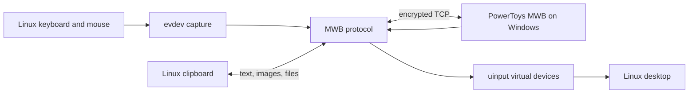

# Architecture

MWB Linux is a native Linux client for Microsoft PowerToys Mouse Without
Borders. It can receive input from Windows and, in bidirectional mode, send
Linux input back to Windows. Two mwb-linux instances can also pair with each
other (`peer = "linux"`).

## Runtime overview

The process has four main jobs:

1. Maintain an encrypted MWB connection with the configured Windows machine.
2. Inject incoming keyboard and mouse packets through Linux `uinput` devices.
3. In bidirectional mode, detect the configured screen edge, capture local
   `evdev` events, and forward them to Windows.
4. Synchronize clipboard text, images, and supported file selections.

## Connections and ports

PowerToys uses two adjacent TCP ports:

| Channel | Default port | Purpose |
| --- | ---: | --- |
| Clipboard | 15100 | Files and oversized clipboard payloads |
| Control | 15101 | Handshake, input, heartbeat, and clipboard notifications |

The base port is configurable. The control port is always `base + 1`.

MWB Linux listens and dials at the same time. The first authenticated control
connection wins, which keeps reconnects quick after either machine sleeps or
restarts.

### Linux groups

With `peer = "linux"` the other ends are mwb-linux machines, not PowerToys,
and the machine joins a group of two to six (`internal/group`). A PowerToys
peer (`peer = "windows"`, the default) gets none of this and keeps the
original single-connection loop in `cmd/mwb/main.go`.

1. **Membership.** Every member connects to every other one, one `link` per
   member. The listener's connections are routed to links by the name in
   the handshake. `host` is only a bootstrap: once its owner is known, that
   member's link dials it. Each member sends a group document listing the
   members it knows and the address it reaches each at, so a machine that
   was given one address learns the rest. Learned addresses persist in
   `$XDG_STATE_HOME/mwb/members.json`. A connection that reaches a different
   machine than its link expects is handed to that machine's link.
2. **Pairing.** For each pair both machines dial, and both keep the
   connection dialed by the machine whose name sorts first
   (`network.PreferOutbound`), falling back to the other after
   `LinuxPeerGrace` (3s), as `network.SelectLinuxPeer` does for one pair.
3. **Idle timeout.** A link silent for `LinuxPeerIdleTimeout` (5s) is
   dropped and redialed. Heartbeats run every second on these links, and
   only heartbeats sent to everyone are answered, so answers are never
   echoed back. A machine whose input drives a member that vanishes takes
   its own cursor back when the link drops.
4. **Group document.** JSON (`group.Info`), split into 12-byte chunks in
   `LinuxGroup` packets (type 101, plain 32-byte packets reusing the
   MOUSEDATA payload; `protocol.GroupChunks` and `GroupAssembler`). It holds
   the layout with its age in seconds, the members, the sender's screen size
   measured with xrandr, whether it shares, its control port, and the
   highest cursor epoch it has seen. Sent on connect and when this machine
   changes the layout.
5. **Layout.** The left-to-right order of machine names, `layout` in the
   config. The most recent choice wins (`Layout.Newer`: later time, then
   lower author name), so every machine converges on one. Ages, not
   timestamps, travel on the wire, so clocks need not agree. Members missing
   from the order are appended in name order (`Complete`), which every
   machine does identically; adding another machine is a new choice and is
   announced, adding only itself is not. A pair with no layout places its
   peer by the old `edge`. Adopted layouts are saved with `SaveLayout`.
6. **One cursor.** The cursor is on one machine at a time. When a machine's
   input moves it across an edge (`capture.Navigator`), that machine sends a
   `LinuxCursor` packet (type 102) to every member: the target's name hash,
   the side it enters from, its height, and an epoch one above the highest
   seen. Everyone follows the highest epoch (ties: lower announcer name), so
   a late announcement changes nothing. The target releases its local input
   (`Arrive`); every other sharing machine isolates its input and forwards it
   to the target (`Follow`), starting at the announced entry point. The
   driving machine walks its virtual cursor across remote screens and hands
   over at each far edge (`crossRemoteLocked`), skipping offline members;
   the ends of the row are walls. The capturer watches only the sides that
   have a neighbour (two XWayland edge windows on Wayland), and is restarted
   when a new layout changes them.
7. **Departures.** When a link ends, keys and buttons it injected are
   released (`network.HeldInput`). If its machine had the cursor, the
   location becomes unknown and each machine takes its own cursor back
   (`Lost`); the next crossing announces a new location.
8. **Two-way default.** An unset `bidirectional` means on.
9. **Wait/Connect.** With no `host`, the machine never bootstraps. Its
   listeners use `AcceptLocalNetwork`, which lets any RFC1918/ULA or
   link-local source attempt the handshake (never loopback or a routable
   address). That is the same set `isAllowedPeer` already admits beyond a
   configured host. File copies go to each member at the address it
   connected from (`Conn.RemoteHost`).
10. **Clipboard.** One manager polls the local clipboard and sends to every
    member online (`clipboard.NewGroupManager`).
11. **Keyboard.** Inbound keys are decoded positionally (`us` profile),
    because a Linux sender encodes physical key positions.

Older mwb-linux builds ignore types 101 and 102, so they connect but cannot
take part; the status file marks such a member `current: false`.

## Encryption and handshake

The implementation follows the PowerToys MWB protocol for compatibility:

- Each direction opens with a 32-byte cleartext header: a 16-byte PBKDF2 salt
  followed by the 16-byte AES IV for that direction. Both are random per
  connection. A peer writes its own header before reading the other's, since
  PowerToys creates its two streams lazily and may read before it writes.
- PBKDF2-SHA512 at 100,000 iterations derives a 32-byte key from the shared
  security key and the salt in that header.
- AES-256-CBC protects the stream.
- Each direction then exchanges a random 16-byte block before protocol traffic
  begins.
- PowerToys used a fixed salt and IV at 50,000 iterations before 0.101. Set
  `legacy_crypto = true` for a Windows peer pinned to an older build.
- Both peers exchange `Handshake` challenges and matching `HandshakeAck`
  responses.
- A `HeartbeatEx` broadcast registers the Linux machine in the PowerToys
  machine pool.

Control packets are 32 bytes, or 64 bytes when they include a machine name:

| Offset | Size | Field |
| ---: | ---: | --- |
| 0 | 1 | Packet type |
| 1 | 1 | Checksum |
| 2 | 2 | Security-key magic value |
| 4 | 4 | Non-zero packet ID |
| 8 | 4 | Source machine ID |
| 12 | 4 | Destination machine ID |
| 16 | 16 | Type-specific payload |
| 32 | 32 | Optional machine name |

Packet definitions and encoding live in `internal/protocol`. Connection setup
and dispatch live in `internal/network`.

## Input flow

### Windows to Linux

PowerToys sends mouse and keyboard packets over the control connection. MWB
Linux maps Windows virtual-key codes to Linux evdev codes and writes events to
its `mwb-mouse` and `mwb-keyboard` uinput devices.

Keyboard packets do not carry hardware scan codes or Unicode text. The
`keyboard_layout` profile handles common Windows layouts; unknown layouts use
the US-compatible mapping.

### Linux to Windows

Bidirectional mode requires X11 or XWayland. On X11, one persistent X11
connection queries the pointer position every 10 ms. On Wayland that position
is frozen, because XWayland only tracks the pointer over X11 windows, so MWB
Linux maps a transparent one-pixel override-redirect window along the edge
and treats its motion events as the edge touch. XWayland sends no leave event,
so the edge re-arms after the physical mouse moves `rearmDistance` raw units
inward. When the pointer reaches the selected edge, MWB Linux:

1. Takes an exclusive `EVIOCGRAB` on physical keyboards and pointers.
2. Sends an entry-position mouse burst to Windows.
3. Converts local evdev movement into MWB mouse packets while tracking a
   virtual cursor on the remote screen.
4. Returns control when that virtual cursor reaches the shared return edge.
5. Moves the Linux cursor safely inside the screen before releasing grabs.

Cursor entry uses 8% of the configured remote desktop width when entering
Windows and a 50-pixel inset when returning to Linux. The initial Windows
packet and the tracked virtual cursor use the same position. Linux returns
preserve the tracked vertical position and use the existing X11 connection to
move the cursor before releasing input. Both directions retain the inward
movement gate before another crossing can trigger. These are internal defaults,
not additional configuration options.

`EVIOCGRAB` is tied to each open file descriptor. The kernel releases it if the
process exits or crashes, so input recovery does not depend on a cleanup
command running successfully.

## Clipboard and files

Text and images use clipboard packets on the control stream. Files use the
separate clipboard port and have their own handshake and framing. See
[File transfer](file-transfer.md) for the full flow and safety rules.

## Status file

The client writes its connection state as JSON to
`$XDG_RUNTIME_DIR/mwb/status.json`, and `mwb-gui` reads it.

- It holds no secrets.
- The directory is 0700 and the file is 0600.
- Each update is written to a temporary file and renamed into place.
- The file is removed on clean shutdown. Readers ignore a file whose recorded
  PID no longer exists.
- When `XDG_RUNTIME_DIR` is unset, nothing is written. The client never falls
  back to a shared directory.

## Important invariants

These rules prevent failures that are difficult to recover from or reproduce:

- `network.Conn.SendPacket` must hold `sendMu` for the complete encrypted write.
  CBC stream state is mutable and concurrent writes corrupt it.
- Capture code must release `Capturer.mu` before calling `applyIsolation`, which
  acquires that mutex itself.
- Only physical keyboard and pointer devices may be grabbed. Virtual uinput
  devices, power buttons, switches, and unrelated controllers must remain
  untouched.
- Input devices must be opened non-blocking. `Stop` closes every descriptor and
  waits for monitor goroutines to exit.
- The tracked device set must be refreshed before isolation so newly connected
  hardware cannot leak local movement while Windows owns the cursor.
- Return packets must match the configured shared edge. A packet from another
  edge must not reclaim the Linux cursor.
- The cursor must move away from an edge before switching can re-arm. This gate
  prevents immediate bounce loops in both directions.
- Two Linux peers must evaluate the same pairing rule. `preferOutbound`
  compares names exactly as they appear on the wire, with trailing padding
  trimmed. Any change to the rule must stay symmetric:
  `preferOutbound(a, b) != preferOutbound(b, a)`.
- Group packets (`LinuxGroup`, `LinuxCursor`) are sent only between
  mwb-linux machines. The PowerToys path must send exactly the packets it
  always has.
- Every member must decide layout and cursor conflicts the same way:
  `Layout.Newer` and the epoch rule in `applyCursor` depend only on values
  all members see, never on which machine evaluates them.
- `AcceptLocalNetwork` must never widen beyond `isLocalNetwork`. Loopback
  stays refused, and an empty host stays fail-closed.

Tests named after these invariants live beside the relevant package code.

## Package map

| Path | Responsibility |
| --- | --- |
| `cmd/mwb` | CLI, startup, reconnect loop, and component wiring |
| `internal/capture` | X11 edge detection, evdev capture, and device isolation |
| `internal/clipboard` | Text, image, and file-selection clipboard handling |
| `internal/config` | TOML configuration |
| `internal/group` | Linux groups: membership, layout sync, cursor location |
| `internal/filetransfer` | File-channel framing and safe receive/write logic |
| `internal/input` | uinput devices and keyboard mappings |
| `internal/network` | TCP connections, handshakes, routing, and heartbeats |
| `internal/protocol` | Packet encoding, encryption, and protocol constants |
| `internal/selfupdate` | Verified GitHub release updates |
| `internal/status` | Connection status file for the settings window |
| `gui/` | `mwb-gui` settings window (Python, GTK 4; separate from the binary) |

## Platform boundary

Receive-only input works through Linux uinput without an X11 capture backend.
Bidirectional edge detection and cursor repositioning currently use X11 or
XWayland. Native Wayland capture and clipboard support require compositor or
desktop-portal integration and are tracked separately in GitHub issues.
